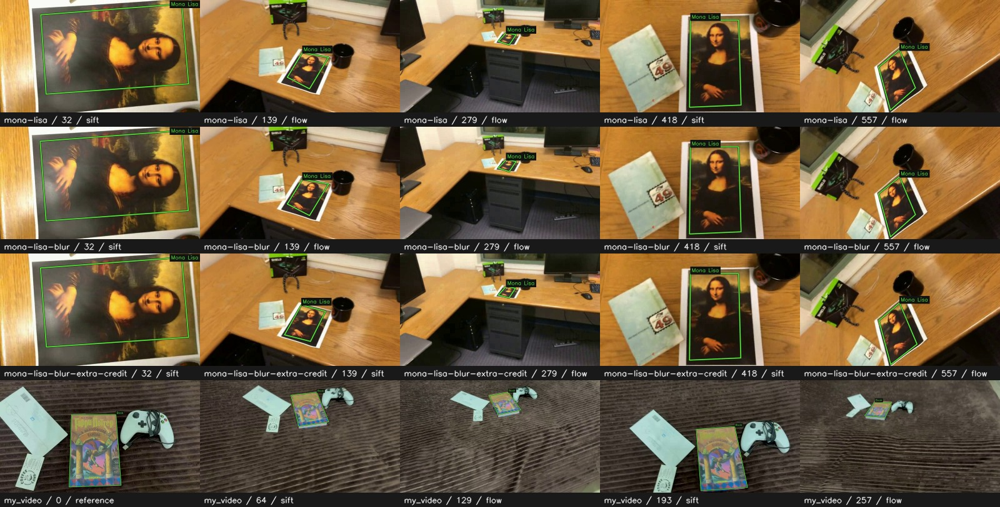

# Отчёт по лабораторной работе № 2

## 1. Цель и постановка задачи

Цель работы - разработать программу, которая отслеживает плоский объект на видео по ключевым точкам. Первый кадр, снятый крупным планом, задаёт эталон. На последующих кадрах программа должна рисовать подписанную рамку вокруг видимого объекта с учётом его положения, масштаба, поворота и перспективы.

Реализация написана на Python с использованием OpenCV и NumPy. Для проверки использованы три варианта видео с репродукцией Моны Лизы и собственная запись с книжной обложкой.

## 2. Теоретическая база

### 2.1. Ключевые точки и дескрипторы SIFT

SIFT ищет устойчивые локальные особенности в пространстве масштабов. Ориентация ключевой точки вычисляется по градиентам яркости вокруг неё. Дескриптор описывает распределение этих градиентов в системе координат, связанной с масштабом и ориентацией точки. Благодаря этому одну и ту же деталь можно сопоставить при изменении масштаба и поворота изображения.

Для каждого эталонного дескриптора находят два ближайших дескриптора текущего кадра по евклидову расстоянию. Пусть $d_1$ и $d_2$ - расстояния до первого и второго кандидатов. Сопоставление принимается при $d_1 < 0{,}75d_2$. Это отбрасывает пары, у которых два кандидата почти одинаково похожи на эталон.

### 2.2. Гомография и RANSAC

Координаты одной точки плоского объекта на двух изображениях связаны гомографией $p' \sim Hp$. Здесь $p$ и $p'$ - однородные координаты точки, а $H$ - матрица размером $3 \times 3$. Для оценки гомографии достаточно четырёх соответствий в невырожденной конфигурации. После проекции четырёх углов эталона рамка повторяет перспективное искажение объекта.

RANSAC оценивает модель по нескольким подмножествам соответствий. Каждая модель проверяется по ошибке репроекции. Пары, согласующиеся с выбранной моделью в пределах допуска, называются инлайерами. У каждой оценки дополнительно проверяется распределение инлайеров и геометрия полученной рамки.

### 2.3. Оптический поток

Пирамидальный метод Лукаса - Канаде оценивает смещение точек между соседними кадрами по яркости пикселей в локальном окне. Пирамида изображений помогает находить смещения, которые велики на исходном разрешении. В работе точка переносится на текущий кадр и обратно. Если после обратного переноса она далеко от исходного положения, такое соответствие исключается.

## 3. Описание разработанной системы

### 3.1. Архитектура

В [track.py](track.py) находятся четыре части программы.

| Компонент | Назначение |
| --- | --- |
| `PlanarTracker` | Подготавливает эталон, сопоставляет дескрипторы SIFT и хранит последний кадр и рамку для оптического потока. |
| `reference_corners`, `estimate_corners` | Проверяют границы эталона, оценивают преобразование по соответствиям и возвращают координаты четырёх углов. |
| `Detection`, `annotate` | Хранят координаты, метод и число инлайеров и рисуют рамку с подписью. |
| `track_video`, `main` | Обрабатывают аргументы, читают исходное видео и записывают обработанный ролик и покадровый CSV. |

### 3.2. Последовательность обработки

1. Первый кадр переводится в оттенки серого. Для учебных роликов эталоном служит весь кадр. При передаче `--roi` берётся прямоугольная область, а при передаче `--quad` указанный четырёхугольник выпрямляется до прямоугольного эталона.
2. SIFT вычисляется на масштабах 1, 0,5, 0,25 и 0,125. Копия эталона используется, если её меньшая сторона составляет хотя бы 24 пикселя и найдено не менее 8 ключевых точек. Координаты пересчитываются в координаты эталона. Для SIFT заданы `nfeatures=1800` и `contrastThreshold=0.012`.
3. На каждом следующем кадре `BFMatcher` сопоставляет дескрипторы по норме L2. После проверки отношения расстояний для каждой точки кадра остаётся соответствие с наименьшим отношением. `findHomography` оценивает преобразование методом RANSAC с допуском 3 пикселя. Для принятия гомографии требуется не менее 8 инлайеров.
4. Если гомография отклонена или содержит меньше 24 инлайеров, программа пробует оптический поток. Внутри предыдущей рамки выбирается до 150 точек. Допустимая ошибка обратного переноса - менее 1,25 пикселя. При площади рамки меньше 2200 квадратных пикселей оцениваются сдвиг, поворот и равномерный масштаб. При площади от 2200 квадратных пикселей оценивается полное аффинное преобразование.
5. Обе ветви проверяют, что инлайеров не меньше 35% и их выпуклая оболочка занимает не меньше 4,5% исходной области. Полученная рамка должна быть выпуклой, со сторонами длиной от 6 пикселей. В пределах кадра должно быть видно не меньше 75 квадратных пикселей рамки и не меньше 15% её площади. Для рамки по оптическому потоку дополнительно проверяется сходство выпрямленного изображения с эталоном по нормированной корреляции яркости.
6. Принятая оценка отмечается зелёной рамкой с подписью. При потере объекта кадр записывается без рамки со статусом `lost`. На следующем кадре сопоставление SIFT снова выполняется с первым кадром. Это позволяет повторно найти объект после неудачной локализации.

### 3.3. Установка и запуск

Команды выполняются из папки проекта. `uv` читает зависимости из `track.py` и подготавливает окружение при запуске. По умолчанию используется `test-videos/my_video.MOV`.

```powershell
uv run track.py
```

Три учебных ролика обрабатываются отдельными командами.

```powershell
uv run track.py test-videos/mona-lisa.avi --label "Mona Lisa"
uv run track.py test-videos/mona-lisa-blur.avi --label "Mona Lisa"
uv run track.py test-videos/mona-lisa-blur-extra-credit.avi --label "Mona Lisa"
```

Параметр `--roi X Y W H` задаёт левый верхний угол, ширину и высоту области в пикселях. Параметр `--quad X1 Y1 X2 Y2 X3 Y3 X4 Y4` задаёт четыре вершины по часовой стрелке от левого верхнего угла. Параметр `--label` задаёт подпись. Путь для выходного видео можно изменить через `-o`.

Для каждого файла программа сохраняет в `output/` ролик `<имя>-tracked.mp4` и одноимённый CSV. Видео сохраняет разрешение и частоту кадров источника. MP4 записывается без исходной аудиодорожки. В CSV есть номер кадра с нуля, метод (`reference`, `sift`, `flow` или `lost`), число инлайеров и координаты четырёх углов.

## 4. Результаты работы и тестирования

### 4.1. Условия эксперимента

Учебная часть включает `mona-lisa.avi`, `mona-lisa-blur.avi` и `mona-lisa-blur-extra-credit.avi`. Все три ролика имеют разрешение 640 × 360 и частоту 29,97 кадра/с. Первые кадры использованы целиком. Рамка охватывает участок репродукции, который виден в эталоне. Белая окантовка листа может лежать за её пределами.

Обработка выполнена с Python 3.9.13, OpenCV 4.12.0 и NumPy 2.0.2. На всех роликах использовались одинаковые настройки трекера. Способ задания эталона собственной записи описан в разделе 4.5.

### 4.2. Количественные результаты

| Видео | Кадров с рамкой / всего | Доля | Без рамки | Кадров SIFT | Кадров с оптическим потоком |
| --- | ---: | ---: | ---: | ---: | ---: |
| Обычное (`mona-lisa.avi`) | 528 / 558 | 94,6% | 30 | 287 | 240 |
| С размытием (`mona-lisa-blur.avi`) | 509 / 558 | 91,2% | 49 | 268 | 240 |
| Усложнённое размытие (`mona-lisa-blur-extra-credit.avi`) | 485 / 558 | 86,9% | 73 | 261 | 223 |

Доля рассчитана по числу кадров с принятой рамкой, включая первый кадр со статусом `reference`. Этот первый кадр добавляет единицу к сумме результатов SIFT и оптического потока. Для оценки точности границ потребовалась бы отдельная покадровая разметка углов. В этой работе положение рамки проверялось визуально на выборке.

### 4.3. Примеры локализации

1. После запуска команд из раздела 3.3 для каждого ролика были получены MP4 с рамками и CSV.
2. Через `cv2.VideoCapture` из каждого обработанного MP4 извлечено пять кадров. Для трёх учебных роликов взяты кадры `32, 139, 279, 418, 557`. Для собственного видео взяты кадры `0, 64, 129, 193, 257`. Нумерация начинается с нуля.
3. Каждый кадр уменьшен до 320 × 180 пикселей. Снизу добавлена полоса высотой 23 пикселя с именем ролика, номером кадра и методом из CSV.
4. `np.hstack()` объединяет пять кадров одного видео в строку. `np.vstack()` объединяет четыре строки. Сетка размером 1600 × 812 пикселей сохранена через `cv2.imwrite()` в `results.jpg`.



Первые три строки показывают обычный ролик, размытие и усложнённое размытие. Четвёртая относится к собственной записи. На кадре 279 всех трёх учебных видео картина занимает небольшую часть изображения, и рамку даёт оптический поток. На кадре 345 во всех трёх роликах картина ещё различима, но трекер не построил рамку.

### 4.4. Автоматические проверки

Выполнены автоматические проверки четырёх пар входных и выходных видео. Файлы повторно декодированы. Проверено, что выходные MP4 сохраняют размеры, частоту и число кадров исходника, а CSV содержит одну строку на кадр. Для принятой рамки в CSV записаны четыре пары конечных координат. Строки со статусом `lost` имеют пустые координаты и ноль инлайеров. Числа в таблицах отчёта сверены с CSV.

Отдельно проверено преобразование прямоугольной области `--roi` в четыре угла. Самопересекающийся четырёхугольник отклоняется. Для `my_video.MOV` координаты первого кадра в CSV совпадают с заданной областью эталона.

### 4.5. Собственное видео

В `my_video.MOV` отслеживается передняя обложка книги «Гарри Поттер». Камера меняет расстояние и наклон, рядом с книгой лежат другие предметы. Размер кадра составляет 1280 × 720, частота - 30 кадр/с. Эталон ограничен границами обложки. Координаты `457 220 742 219 775 672 442 683` заданы в программе для запуска без аргументов.

| Кадров с рамкой / всего | Доля | Без рамки | Кадров SIFT | Кадров с оптическим потоком |
| ---: | ---: | ---: | ---: | ---: |
| 247 / 258 | 95,7% | 11 | 154 | 92 |

Все пропуски находятся между кадрами 137 и 175 включительно. На кадре 151 обложка видна, хотя рамка отсутствует. На выборочных кадрах из четвёртой строки иллюстрации рамка следует за обложкой при изменении ракурса и расстояния до камеры.

## 5. Выводы по работе

Разработанный трекер восстанавливает положение плоского текстурированного объекта по первому кадру. На трёх учебных роликах он построил рамку на 86,9–94,6% кадров. Оптический поток дал принятую рамку на 703 кадрах этих роликов. На собственной записи рамка была построена на 247 из 258 кадров.

## 6. Использованные источники

1. Lowe D. G. *Distinctive Image Features from Scale-Invariant Keypoints*. International Journal of Computer Vision, 2004, 60(2), 91–110. [Текст статьи](https://www.cs.ubc.ca/~lowe/papers/ijcv04.pdf)
2. OpenCV. [Feature Matching](https://docs.opencv.org/4.x/dc/dc3/tutorial_py_matcher.html)
3. OpenCV. [Features2D + Homography to find a known object](https://docs.opencv.org/4.x/d7/dff/tutorial_feature_homography.html)
4. OpenCV. [Optical Flow](https://docs.opencv.org/4.x/d4/dee/tutorial_optical_flow.html)
